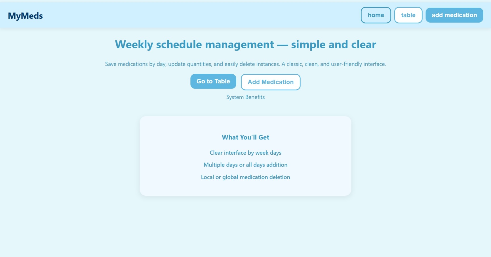
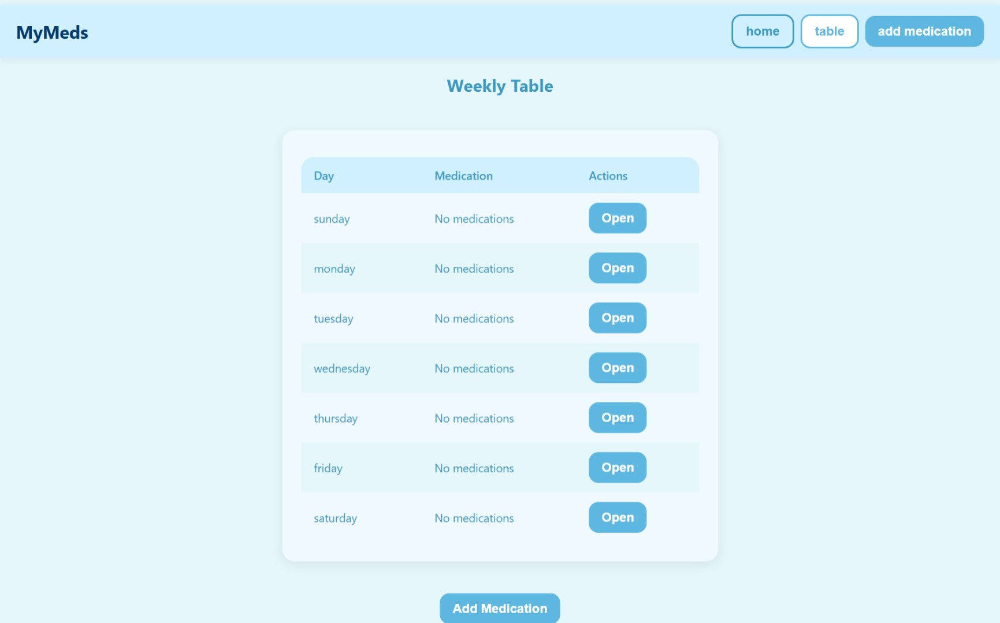
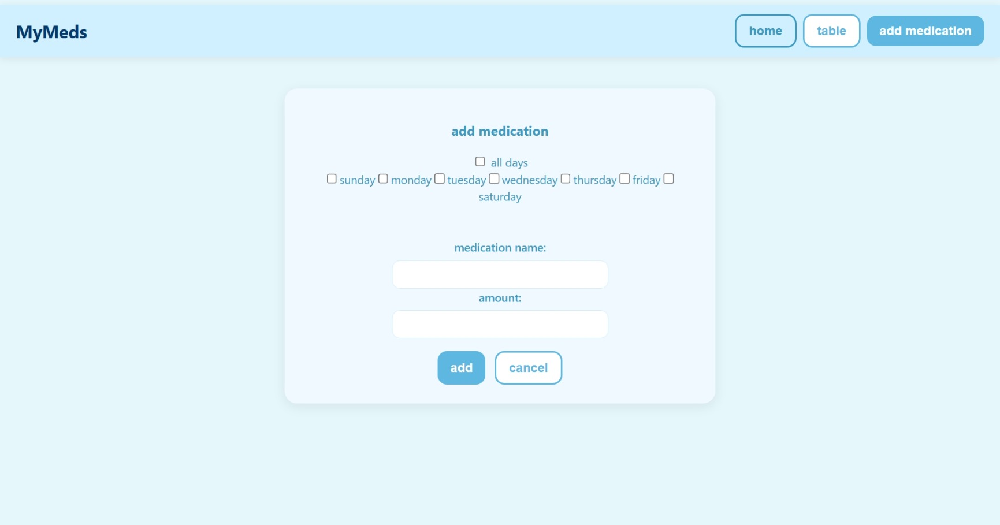

# MyMeds – Weekly Medication Schedule

A React app for managing a weekly medication schedule. Medications are saved per day of the week, and can be added, updated and deleted. Built as a first-year project.

## Features
- Weekly table showing all 7 days and their medications
- Add a medication to one day, several days, or all days at once
- Update the dosage of a medication
- Delete a medication from a single day, or from all days at once
- Day details page with a delete confirmation dialog

## Tech Stack
- React 19
- Redux (global state)
- React Router (navigation)
- Create React App

## Getting Started
```bash
git clone https://github.com/USERNAME/medication-schedule.git
cd medication-schedule
npm install
npm start
```
The app opens at http://localhost:3000.

## Screenshots




## Project Structure
- `src/component` – React components (pages and UI)
- `src/redux` – state management (days and medications)

(Known issues, for future fixing:
1. Data is not saved – refreshing the page resets all medications. Could be fixed with localStorage or a server.
2. `store.jsx` uses the deprecated `createStore`; better to move to `configureStore` from Redux Toolkit. `redux` is also not listed directly in `package.json`.
3. `RequestSlice.jsx` is not used anywhere, and its slice name is "user".
4. Unused code: `logo` import in `App.js`, `dispatch` in `DayDetails.jsx`, and large commented-out blocks in `DayDetails.jsx` and `App.js`.
5. `Home.jsx` contains a leftover "System Benefits" placeholder block.
6. The same medication can be added to the same day twice, and "delete all" matches by exact name (case-sensitive).
7. Only the dosage can be updated, not the medication name.
8. `App.test.js` is the default Create React App test and probably fails.
9. Both `react-router` and `react-router-dom` are in `package.json`, but only `react-router-dom` is used.)
